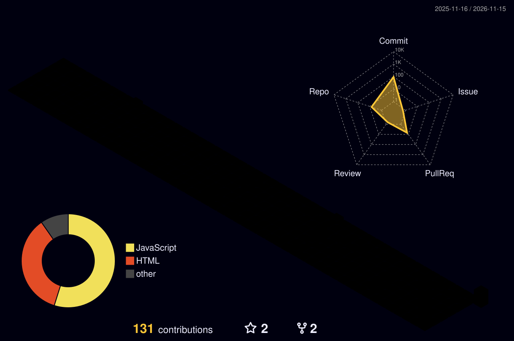

<!--
  GitHub Profile README — devGreenPink
  Dark / minimal / green-cyan accents
-->

# devGreenPink

### Developer · Builder · Problem Solver

Building practical tools and web applications — with a focus on clean interfaces, useful workflows, and thoughtful details.

 

  

---

## About

- I enjoy building tools that solve everyday developer problems.
- Interested in frontend experiences, backend systems, and automation.
- Always learning, experimenting, and improving through real projects.

## Live websites

Only public websites hosted on GitHub Pages are listed here.

| Project | What it does |
| --- | --- |
| **1. [อีสาน Dev Tools](https://devgreenpink.github.io/dev-utility-toolkit/)** | A browser-based developer toolkit with 40 tools across 7 categories. Client-side, no backend required. |
| **2. [MooHao (หมู่เฮา)](https://devgreenpink.github.io/moohao/)** | Send files, photos and messages between iPhone, Android and computers right in the browser — no app, no account, nothing uploaded. Same Wi-Fi or anywhere with a room code, plus a chat for each device. *(formerly Nearby)* |
| **3. [3xxx-Words](https://devgreenpink.github.io/vocab-learning-app/)** | An English vocabulary learning PWA with login, offline support, and responsive design. |

## Tech Stack

### Backend

  
  

### Frontend

  

### Tools & Platform

  

## GitHub Activity

  

  If the streak card doesn't load, you can still view my activity on <a href="https://github.com/devGreenPink">GitHub</a>.

## Contribution snake

  

## 3D contribution graph

  

---

**Thanks for stopping by. Have a great day!** ✨

